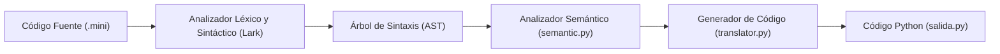

# Mini-Compilador UTEPSA (Transpilador a Python)

Un mini-compilador (específicamente un **transpilador** o compilador fuente a fuente) desarrollado en Python con la biblioteca **Lark**. Toma código fuente escrito en un lenguaje personalizado con extensión `.mini` y lo traduce a código ejecutable en Python.

---

## 💡 ¿Qué es este proyecto? (Explicación sencilla)

Imagina que quieres comunicarte con una computadora, pero has inventado tu propio idioma con palabras personalizadas (por ejemplo, en lugar de escribir `if`, escribes `ifapruebemeinge`). 

Una computadora normal no entendería ese dialecto. Aquí es donde entra este proyecto: funciona como un **traductor inteligente** que realiza tres tareas fundamentales:

1. **Lee y revisa la ortografía y gramática:** Verifica que las oraciones estén bien formadas según las reglas del lenguaje.
2. **Revisa el sentido lógico:** Comprueba que no intentes hacer cosas sin sentido, como sumar una palabra con un número o usar una variable que nunca creaste.
3. **Traduce a Python:** Una vez que comprueba que todo es coherente, genera un archivo en Python (`salida.py`) listo para ejecutarse.

---

## 🏛️ Arquitectura del Compilador

El proceso de compilación sigue el flujo clásico de la teoría de compiladores:



### 1. Análisis Léxico y Sintáctico (`grammar.lark`)
- **Léxico (Lexer):** Convierte el texto en unidades mínimas llamadas *tokens* (números, operadores, identificadores y palabras clave).
- **Sintáctico (Parser):** Utiliza un parser **LALR** provisto por Lark para comprobar que la secuencia de tokens cumpla la gramática y construye un **Árbol de Sintaxis Abstracta (AST)**.

### 2. Análisis Semántico (`semantic.py`)
Valida la coherencia lógica del programa mediante una **Tabla de Símbolos**:
- Comprueba que toda variable sea declarada antes de usarse.
- Evita la redeclaración de variables existentes.
- Realiza **chequeo de tipos** (Type Checking): las operaciones aritméticas (`+`, `-`, `*`, `/`) solo admiten números, y las comparaciones deben ocurrir entre datos del mismo tipo.

### 3. Generación de Código (`translator.py`)
Recorre el árbol de sintaxis validado y emite código Python limpio, manejando la indentación de bloques (`if`/`else`) y garantizando sintaxis válida.

---

## 📖 Especificación del Lenguaje (`.mini`)

### Palabras Clave

| Palabra Clave | Equivalente Python | Descripción |
| :--- | :--- | :--- |
| `varutepsa` | `nombre = valor` | Declaración de variables |
| `printbecas(...)` | `print(...)` | Impresión en consola |
| `ifapruebemeinge (...)` | `if ...:` | Estructura condicional |
| `elsenomerepruebe` | `else:` | Alternativa condicional |

### Tipos de Datos y Operadores
- **Números:** Enteros y decimales (`10`, `3.14`).
- **Cadenas de texto:** Entre comillas dobles (`"Hola mundo"`).
- **Operaciones Aritméticas:** Suma (`+`), Resta (`-`), Multiplicación (`*`), División (`/`), Negación (`-x`).
- **Operadores de Comparación:** `==`, `!=`, `<`, `>`, `<=`, `>=`.
- **Comentarios:** Líneas que inician con `//` son ignoradas por el analizador.

---

## 📂 Estructura de Archivos

```text
minicompilador/
│
├── grammar.lark        # Gramática formal del lenguaje (reglas léxicas y sintácticas)
├── main.py             # Punto de entrada principal y orquestador del pipeline
├── semantic.py         # Análisis semántico, validación de tipos y tabla de símbolos
├── translator.py       # Generador de código fuente hacia Python
├── requirements.txt    # Dependencias del proyecto (lark)
├── salida.py           # Código Python resultante generado tras compilar
│
├── ejemplos/
│   ├── edades.mini          # Ejemplo básico de condicionales
│   ├── promedio.mini        # Cálculo aritmético y precedencia de operadores
│   ├── descuento.mini       # Operaciones de resta y comparaciones lógicas
│   └── error_semantico.mini # Ejemplo para defensa (demostración de chequeo de tipos)
│
└── README.md           # Documentación del proyecto
```

---

## ⚡ Guía Paso a Paso para Probar el Proyecto

Sigue estos sencillos pasos para clonar, configurar y ejecutar el proyecto en tu computadora:

### Paso 1: Clonar el repositorio
```bash
git clone https://github.com/RonaldGaymer2002/MiniCompilador.git
cd MiniCompilador
```

### Paso 2: Crear y activar un entorno virtual

**En Windows (PowerShell):**
```powershell
python -m venv .venv
.\.venv\Scripts\Activate.ps1
```
*(Si no tienes permisos para activar scripts en PowerShell, puedes usar directamente el comando `.\.venv\Scripts\python.exe` en los siguientes pasos).*

**En Linux / macOS:**
```bash
python3 -m venv .venv
source .venv/bin/activate
```

### Paso 3: Instalar las dependencias
Instala la librería `lark` con un solo comando:
```bash
pip install -r requirements.txt
```

### Paso 4: Compilar el archivo de ejemplo
Ejecuta el compilador indicando el archivo `.mini` que deseas traducir:
```bash
python main.py ejemplos/edades.mini
```

**Salida en consola:**
```text
1. Analisis sintactico: Correcto
Analisis semantico correcto

Tabla de simbolos:
edad: number

2. Traduccion a Python: Correcta

Codigo Python generado:
edad = 22
if edad >= 18:
    print("Estas aprobado")
else:
    print("Estas reprobado")

Archivo salida.py generado correctamente.
```

### Paso 5: Ejecutar el código Python generado
Verifica que el programa final funciona ejecutando el archivo generado:
```bash
python salida.py
```

**Resultado obtenido:**
```text
Estas aprobado
```

---

## 🛡️ Detección de Errores Semánticos

Si el código tiene errores lógicos, el compilador detendrá el proceso y mostrará el motivo exacto:

- **Variable no declarada:**
  ```text
  SemanticError: La variable 'x' no ha sido declarada.
  ```
- **Redeclaración de variable:**
  ```text
  SemanticError: La variable 'edad' ya fue declarada.
  ```
- **Tipos incompatibles en operaciones:**
  ```text
  SemanticError: Las operaciones aritmeticas solo admiten numeros.
  ```
- **Comparación entre tipos incompatibles:**
  ```text
  SemanticError: No se pueden comparar tipos de datos diferentes.
  ```
